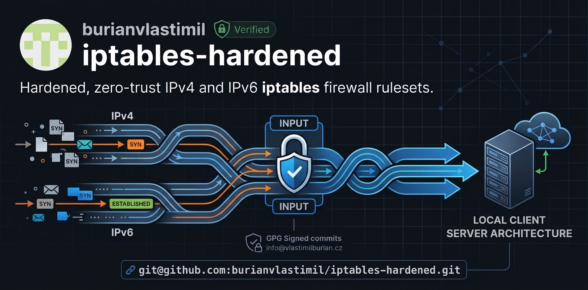

<p align="center">
  
</p>

# iptables-hardened

Production-ready, minimal, and hardened IPv4 and IPv6 Netfilter firewall rulesets designed for modern Linux environments. Built on a strict **Zero-Trust** posture with default-drop policies, stateful inspection, and precise local subnet isolation.

---

## 🛡️ Security Architecture & Key Features

* **Default-Drop Posture:** All incoming (`INPUT`) and forwarded (`FORWARD`) traffic is dropped by default; outbound traffic (`OUTPUT`) is fully allowed.
* **Stateful Inspection:** Leverages connection tracking (`conntrack`) to seamlessly allow established and related sessions while inspecting new connection attempts.
* **Anti-Spoofing & Loopback Protection:** Secures the loopback interface (`lo`) and explicitly drops packets attempting loopback spoofing from external interfaces.
* **TCP Sanity Checks:** Rejects new incoming TCP packets that do not start with a valid `SYN` flag (mitigating stealth scans and malformed handshake attempts) using `REJECT --reject-with tcp-reset`.
* **SSH Hardening & Rate Limiting:** 
  * Restricted exclusively to trusted local scopes (Link-Local `fe80::/10` for IPv6, LAN `192.168.0.0/24` for IPv4).
  * Protected via the `recent` module: enforces a strict rate limit of **3 new connections per minute per IP**, instantly dropping brute-force attempts.
* **Restricted Local Services (NFS & LocalSend):**
  * **NFS (TCP 2049):** Strictly locked down to the local network (`fe80::/10` / `192.168.0.0/24`), hiding file shares from the public internet (compliant with *RFC 7530* and *RFC 8881* standards).
  * **LocalSend (TCP/UDP 53317):** Secured for local peer-to-peer file transfers and device discovery within the trusted subnet only.
* **Optimized IPv6 & ICMPv6 Integration:**
  * Rate-limited IPv6 Pings (Echo Requests).
  * Essential ICMPv6 error handling (Destination Unreachable, Packet Too Big for Path MTU Discovery, Time Exceeded, Parameter Problem).
  * Strict Hop Limit verification (`HL == 255`) for Neighbor Discovery (NDP) and Router Advertisement (RA) messages to prevent off-link spoofing.
* **Dedicated Public Bindings:** Isolated torrenting traffic (qBittorrent) bound strictly to a pre-reserved global IPv6 address.

---

## 📁 Repository Structure

```text
├── rules.v4        # IPv4 Netfilter ruleset
├── rules.v6        # IPv6 Netfilter ruleset
├── README.md       # Documentation
└── LICENSE         # Lisense
```
